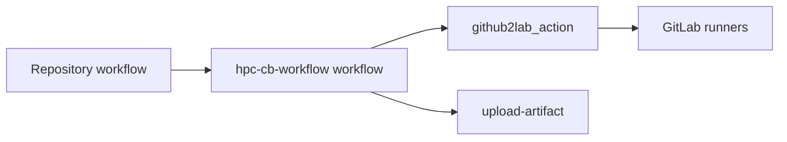

# HPC CB workflow

This reusable GitHub workflow runs pipelines through GitLab runners.
It mirrors commits, triggers pipelines, reports results and collects artifacts.
The caller supplies its events, GitLab pipeline and cluster configuration.



The workflow uses `pc2/github2lab_action` for GitLab operations.
GitHub's checkout and artifact actions handle source files and uploads.
All action references use full commit hashes.
The pinned action must recognize waiting pipelines and validate polling responses.
Dependency updates must use the same published action hash in both workflows.
Run the workflow tests against that published revision.

## Setup

1. Create a GitLab project with runners matching the caller's job tags.
   The caller's `.gitlab-ci.yml` defines the jobs and their resources.
2. Allow the access token to push and force push the mirrored branches.
   Disable pull mirroring for branches managed by this workflow.
3. Create a [GitLab access token][access-token] for this project.
   It needs `read_api` and `write_repository` scopes.
4. Create a token in GitLab Settings, CI/CD, Pipeline trigger tokens.
   Its owner can start the selected branch and supply pipeline variables.
   Cluster authorization may require a trigger token owned by a cluster user.
5. Configure the following settings in the caller's GitHub repository.
   They live under Settings, Secrets and variables, Actions.

| Setting | Type | Value |
| --- | --- | --- |
| `GITLAB_TOKEN` | Secret. | The access token. |
| `GITLAB_TRIGGER_TOKEN` | Secret. | The pipeline trigger token. |
| `GITLAB_HOSTNAME` | Variable. | The hostname without a protocol prefix. |
| `GITLAB_PROJECT_ID` | Variable. | The numeric GitLab project ID. |

The [manual caller example](examples/manual.yml) reads these settings.
Callers can also pass the hostname and project ID directly as inputs.
This workflow receives credentials from the caller.
It needs no GitLab secrets in its own repository.

[access-token]: https://docs.gitlab.com/user/project/settings/project_access_tokens/

## Caller interface

The caller grants `contents: write`, `checks: write` and `actions: write`.
Benchmark publishing also requires `pages: write` and `id-token: write`.
It also grants `pull-requests: write` for result comments.
The [complete example](examples/manual.yml) supports manual dispatch.
Replace `REVIEWED_COMMIT` with the published workflow commit.

```yaml
permissions:
  contents: write
  checks: write
  actions: write
  pull-requests: write
  pages: write
  id-token: write

jobs:
  hpc:
    uses: pc2/hpc-cb-workflow/.github/workflows/hpc-pipeline.yml@REVIEWED_COMMIT
    with:
      gitlab_hostname: gitlab.example.org
      gitlab_project_id: '123'
      pipeline_variables: EXPECTED_COMMIT_SHA=${{ github.sha }}
    secrets:
      GITLAB_TOKEN: ${{ secrets.GITLAB_TOKEN }}
      GITLAB_TRIGGER_TOKEN: ${{ secrets.GITLAB_TRIGGER_TOKEN }}
```

The caller passes `EXPECTED_COMMIT_SHA` to the GitLab pipeline.
The GitLab workflow accepts triggers only when that value matches its commit.
This prevents jobs for a different branch head from starting.
Keep this rule in every mirrored commit, identity checks after triggering cannot prevent jobs from starting.

```yaml
workflow:
  rules:
    - if: >-
        $CI_PIPELINE_SOURCE == "trigger" &&
        $EXPECTED_COMMIT_SHA == $CI_COMMIT_SHA
```

| Input | Meaning |
| --- | --- |
| `gitlab_hostname` | The GitLab hostname without a protocol prefix. |
| `gitlab_project_id` | The numeric GitLab project ID. |
| `pipeline_variables` | Pipeline variables, one `KEY=VALUE` per line. |
| `context_run_id` | The original GitHub run, used to resume monitoring. |
| `pull_request` | An optional PR whose head is the selected commit. |
| `source_sha` | A reviewed PR head commit, verified against `pull_request`. |
| `benchmark` | Optional publication configuration and suites as JSON. |
| `max_wait_minutes` | Minutes one run monitors before continuing in another run, at most 330. |

## Monitoring and results

The workflow starts, monitors and collects the pipeline, then optionally compares and publishes benchmarks.
Start force pushes the selected commit to the same branch on GitLab.
GitLab workflow rules reject push pipelines, one explicit trigger starts the jobs.
Mirroring uses `MIRROR_ONLY=true` and does not add `ci.skip`.
It does not start another pipeline when GitLab already has the commit.
An optional PR number is checked against the selected commit before starting.
The pipeline identity and PR are stored in the original run's context artifact.
Only the first [run attempt][run-attempt] of a new GitHub run may start a pipeline.
Rerunning jobs uses the saved context without mirroring or triggering again.
If the context is missing, rerunning fails without starting jobs.
Check GitLab for an existing pipeline before dispatching a new run in that case.

[run-attempt]: https://docs.github.com/en/actions/reference/workflows-and-actions/contexts#github-context

Wait verifies the context's repository, workflow, branch and original commit.
It also verifies the GitLab project, pipeline ID, branch and commit.
Check names contain project and pipeline IDs to separate concurrent runs.
After `max_wait_minutes`, 330 by default, it dispatches the caller again with `context_run_id`.
Waiting for resources, callbacks, manual approval or a scheduled start remains nonterminal.
Cancellation remains nonterminal until GitLab confirms completion.
Continuation dispatches use the trusted default branch's workflow.
That branch contains a caller accepting the same continuation input.
The new run skips start and monitors the same pipeline.
The saved context preserves the original commit and PR as the branch advances.
Automatic continuation fails after seven days without dispatching another run.
The summary contains the original run ID for manual recovery.
Set `context_run_id` to that ID in the default branch caller to resume manually.
Continuation requires the access token, the trigger token is optional.
The caller exposes `context_run_id` as a workflow dispatch input.

Collect runs when the pipeline finishes, including after test failures.
It uploads artifacts to GitHub with a retention of thirty days.
Context artifacts have the same retention and contain no credentials.
Collection fails when the pipeline fails or its artifacts are unavailable.
For PR runs, one bot comment per pipeline reports the tested commit and result.
The comment includes artifact outcomes and links to GitLab and GitHub.
Repeated collection updates that comment.
The workflow publishes artifacts and PR status comments.
The benchmark caller publishes measurement history through GitHub Pages.

## Execution and credentials

Main branch pushes, manual dispatch and scheduled callers execute this workflow.
Maintainers authorize the exact source commit before cluster execution.
Main branch pushes and scheduled runs require code review before merging.
Review the caller workflow, GitLab configuration, included scripts and dependencies as executable code.
Dispatch a repository branch containing the reviewed commit and prevent changes until the run selects it.
Pass `source_sha` and `pull_request` to select a reviewed PR head, including a fork commit.
The caller runs from the trusted default branch, the selected source is mirrored to a dedicated GitLab branch.
The PR number verifies commit identity, it does not grant approval.
Protect the default branch and restrict workflow dispatch and repository configuration to trusted maintainers.
The default branch caller and its dependencies must remain trusted for automatic continuation.
Trust the configured GitLab host, project administrators and runner operators with the credentials and results.
Jobs execute with the CI account's filesystem and scheduler permissions.
This workflow provides no sandbox for approved source code.
Review includes access to that account's files, credentials and network resources.

GitLab tokens are passed only to the steps that use them.
Only start receives the trigger token.
Wait can update checks and dispatch the caller.
Collect can comment on PRs and has no workflow dispatch permission.
Steps share the runner and filesystem.
Artifact upload receives no explicit GitLab token.
Collected archives are stored without extraction or execution.
Python setup runs outside the source checkout with isolated imports.
The artifact download dependencies are pinned to pure Python wheels by hash.
The temporary authenticated GitLab remote is removed after mirroring.

## Verification

The repository's CI runs `tests/test_workflow.py` with mocked API responses.
It runs on pushes, pull requests and manual dispatch without GitLab secrets.
It does not validate live runner access or GitHub artifact transfers.
It checks exact commit mirroring, pipeline identity and failure propagation.
It also verifies token scopes, automatic continuation and repeated PR reporting.
Tests use PyYAML and the same pinned action revision as the workflow.
`GITHUB2LAB_SOURCE` selects that action's local Git checkout.
These checks submit no GitLab or Slurm jobs.
Local tests can use an uncommitted action worktree at the pinned base revision.
Passing those tests does not publish the action changes or update the workflow pins.

### Integration

The [integration workflow](.github/workflows/integration.yml) calls the reusable workflow without mocks.
It mirrors this repository's commit, its [pipeline](.gitlab-ci.yml) runs on the configured GitLab project.
Configure `GITLAB_HOSTNAME`, `GITLAB_PROJECT_ID`, `GITLAB_TOKEN` and `GITLAB_TRIGGER_TOKEN` in this repository as described in [Setup](#setup).
The GitLab project needs a runner with the `otus-shell` tag, override `INTEGRATION_RUNNER_TAG` in the project's CI/CD variables for another runner.
The integration suite runs every scenario on pushes to `main` and weekly.
Maintainers can also dispatch the suite or an individual scenario.
The suite starts separate runs and follows each continuation to completion.
It checks the saved report, pipeline identity and verification job outcome.
Expected failures pass the suite only when all verification checks pass.
The child runs remain red when they deliberately test a failed pipeline.
Use the suite checks for branch protection rather than the deliberate failures.
The `verify` job reads the context artifact and compares GitLab and GitHub state.
It checks the pipeline commit, trigger variables, job results, check runs, collected archives and the PR comment.

| Scenario | Pipeline | Verified behavior |
| --- | --- | --- |
| `success` | One job with an artifact. | Collection, check runs and the PR comment. |
| `failure` | One failing job. | Artifacts are collected and the `hpc` job fails, the run is red by design. |
| `handover` | One job sleeping five minutes. | Monitoring stops after one minute and dispatches a continuation run. |
| `handover_failure` | A job sleeps five minutes, writes an artifact and fails. | Continuation reports failure and collects the failed job's artifact. |
| `benchmark` | A Julia dense linear solve. | Measurement JSON is collected with the tested commit. |

The continuation run uses the default branch's integration workflow and verifies the completed pipeline.
Merge changes to the continuation path before testing them with `handover`.
Set `pull_request` to a PR whose head is the selected commit to verify the PR comment.

### Benchmark publishing

Pass `benchmark` to enable the pinned `github-action-benchmark` action after successful artifact collection.
Each suite selects a GitLab job archive and one file inside it.
The default format is `customSmallerIsBetter`, `customBiggerIsBetter` and `julia` are also supported.
Custom JSON contains an array of objects with `name`, `unit` and `value`.
The Julia format expects the estimated results exported by `BenchmarkTools.save`.

```yaml
benchmark: >-
  {"mode":"history","branch":"hpc-results","suites":[
    {"name":"CPU Julia 1.10","archive":"benchmark.zip",
     "file":"results/benchmark.json","directory":"bench/cpu",
     "alert_threshold":"115%","fail_threshold":"150%"}]}
```

`history` stores results and the generated dashboard on the configured branch.
`pages` also deploys that branch through the official Pages actions.
`compare` checks results without updating the history branch.
PR measurements always compare without updating history, regardless of the configured mode.
Only default branch measurements can update history.
The workflow initializes the history branch on its first recording run.
Thresholds describe ratios, `115%` warns about a slowdown greater than fifteen percent and `150%` fails above fifty percent.
Suite names must remain stable, separate hardware, Julia versions and thread configurations into distinct suites.
Use separate directories for independent dashboards.
All suites in one caller are processed sequentially.
Avoid overlapping recording callers that write the same branch, GitHub concurrency retains only one pending job.

The action compares against the latest recorded result for that suite with a different commit.
It does not run the PR base revision again.
PR comparisons fail when no baseline exists, custom measurements also require matching names and units.
The PR comment and dedicated commit check report the measured commit, baseline and regression verdict.
Correctness tests and JUnit reports remain the responsibility of the application's test pipeline.

The original context retains the source commit and benchmark configuration during continuation.
Recording retries reuse a receipt stored with the history, PR retries reuse a thirty day comparison artifact.
Retries preserve the recorded verdict and do not append another measurement.
A fresh manual run creates another measurement, even for the same commit.
History stays on the results branch independently of artifact retention.

For standalone Pages, select GitHub Actions in Settings, Pages.
The default dashboard is available below `/bench/` on the published site.
For an existing documentation site, use `history` and copy the configured directory from the results branch into the documentation build.
The documentation workflow remains responsible for deploying its complete site.
A separate documentation repository can fetch this history during its own build.
The reusable workflow writes history in the caller repository, publishing directly to another repository is left to that repository's workflow and credentials.
The `benchmark-site` artifacts also make generated files available for custom integration.

### Julia integration measurement

The benchmark caller runs on pushes to `main`, manual dispatch and Mondays at 06:00 UTC.
It measures a warmed dense linear solve with 512 unknowns using one Julia thread and one BLAS thread.
Seven samples and a residual check accompany the median, a second file contains the benchmark action's custom JSON.
The shared shell runner introduces timing noise, this workload verifies integration rather than enforcing application performance targets.
The example uses permissive thresholds, applications should configure thresholds for their allocated hardware.
The GitLab job loads `lang/JuliaHPC/1.10.12-foss-2025a`, override `BENCHMARK_JULIA_MODULE` if needed.

### PR command integration test

The `/hpc` command authorizes the current PR head and dispatches the default branch caller.
Later pushes require another command.
`CB_COMMAND_ROLES` defaults to `admin maintain`, `CB_COMMAND_WORKFLOW` defaults to `hpc-pr.yml`.
The provided caller uses controlled measurements to test regression reporting and continuation.
Application callers select their own GitLab jobs and benchmark suites.

Configure these settings in this repository to enable the live PR integration test.

| Setting | Type | Value |
| --- | --- | --- |
| `CB_TEST_TOKEN` | Actions secret. | A fine grained token restricted to this repository with pull requests read and write permission. |
| `CB_TEST_ACTOR` | Actions variable. | The GitHub username owning the token. |

The account can be your existing organization member account, no separate bot account is required.
Approve the token in the organization if its policy requires approval.
Enable Allow GitHub Actions to create and approve pull requests under Settings, Actions, General.
The automatic workflow token creates test branches and draft PRs, the supplied token only posts `/hpc`.
Comments posted with the automatic token cannot trigger the comment workflow.
The configured test actor is authorized only for generated PRs changing the controlled fixture.
Regular maintainer authorization still applies to other PRs.

On main pushes, manual runs and the weekly schedule, the integration suite records a baseline on `hpc-test-results`.
It creates passing and failing draft PRs, posts the command and verifies continuation, PR comments and checks on the selected commits.
It reruns reporting to verify that comments are updated and the baseline remains unchanged.
An always running cleanup step closes the PRs and removes their GitHub branches without merging them.
A canceled or interrupted run can leave resources behind, their names contain the originating run ID.
The test uses the configured GitLab runner, the controlled failure does not depend on timing noise.

The separate benchmark action checks run on pushes and PRs without cluster credentials.
They execute the pinned action against deterministic improvement, warning and failure measurements in both metric directions.
Local tests cover input validation, authorization, context verification and reporting helpers.
Reusable workflows embed the tested Python helpers so they execute independently of the caller's checkout.
After editing helpers or templates, run `python scripts/embed_helpers.py` and commit the generated workflows together with their sources.
