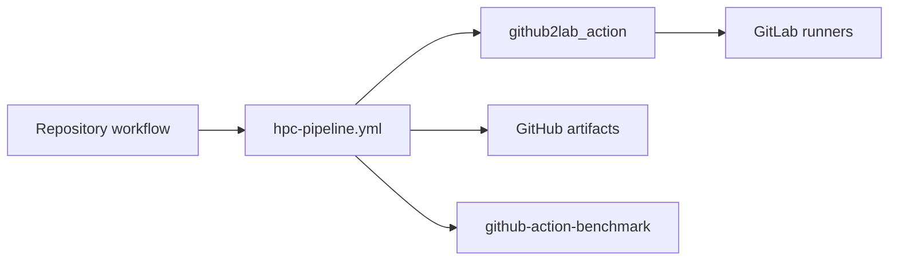

# HPC CB workflow

This reusable GitHub workflow runs a GitLab pipeline for a selected commit and reports the result back to GitHub.
It mirrors the commit, triggers the pipeline, monitors it, collects artifacts and optionally publishes benchmarks with [github-action-benchmark][gab].
The caller supplies its events, GitLab pipeline and cluster configuration.



GitLab operations use `pc2/github2lab_action`, all action references are pinned to commit hashes.

[gab]: https://github.com/benchmark-action/github-action-benchmark

## Setup

1. Create a GitLab project with runners matching the job tags in the caller's `.gitlab-ci.yml`.
2. Create a [project access token][access-token] with the `read_api` and `write_repository` scopes.
   It must be allowed to force push the mirrored branches, the default branch and `hpc-pr-*`, so allow force push for the default branch if it is protected.
   Disable pull mirroring for them.
3. Create a pipeline trigger token under Settings, CI/CD, Pipeline trigger tokens.
   Cluster authorization may require a trigger token owned by a cluster user.
4. Configure the caller's GitHub repository under Settings, Secrets and variables, Actions.

| Setting | Type | Value |
| --- | --- | --- |
| `GITLAB_TOKEN` | Secret. | The project access token. |
| `GITLAB_TRIGGER_TOKEN` | Secret. | The pipeline trigger token. |
| `GITLAB_HOSTNAME` | Variable. | The hostname without a protocol prefix. |
| `GITLAB_PROJECT_ID` | Variable. | The numeric GitLab project ID. |

[access-token]: https://docs.gitlab.com/user/project/settings/project_access_tokens/

## Usage

The [manual example](examples/manual.yml) and [benchmark example](examples/benchmark.yml) are complete callers.
Replace `REVIEWED_COMMIT` with the published workflow commit.
The four dispatch inputs are required, continuation dispatches the caller with `context_run_id` and the PR command dispatches it with `pull_request`, `source_sha` and `command_comment`.
Save the caller as `hpc-pr.yml` or name it in the `CB_COMMAND_WORKFLOW` variable.
GitLab reads `.gitlab-ci.yml` from the mirrored commit, so it lives in the caller repository.

```yaml
on:
  push:
    branches: [main]
  workflow_dispatch:
    inputs:
      context_run_id:
        type: string
        default: ''
      pull_request:
        type: string
        default: ''
      source_sha:
        type: string
        default: ''
      command_comment:
        type: string
        default: ''

permissions:
  contents: write
  checks: write
  actions: write
  pull-requests: write
  pages: write
  id-token: write

jobs:
  hpc:
    uses: pc2/hpc-cb-workflow/.github/workflows/hpc-pipeline.yml@REVIEWED_COMMIT
    with:
      gitlab_hostname: ${{ vars.GITLAB_HOSTNAME }}
      gitlab_project_id: ${{ vars.GITLAB_PROJECT_ID }}
      context_run_id: ${{ inputs.context_run_id }}
      pull_request: ${{ inputs.pull_request }}
      source_sha: ${{ inputs.source_sha }}
      command_comment: ${{ inputs.command_comment }}
      pipeline_variables: EXPECTED_COMMIT_SHA=${{ inputs.source_sha || github.sha }}
    secrets:
      GITLAB_TOKEN: ${{ secrets.GITLAB_TOKEN }}
      GITLAB_TRIGGER_TOKEN: ${{ secrets.GITLAB_TRIGGER_TOKEN }}
```

The GitLab pipeline must accept only triggers for the mirrored commit, otherwise jobs for another branch head can start.
Two pushes to the default branch within seconds mirror different commits to the same GitLab branch, the rule then fails the older run instead of testing the wrong commit.

```yaml
workflow:
  rules:
    - if: >-
        $CI_PIPELINE_SOURCE == "trigger" &&
        $EXPECTED_COMMIT_SHA == $CI_COMMIT_SHA
```

| Input | Meaning |
| --- | --- |
| `gitlab_hostname` | The GitLab hostname without a protocol prefix. |
| `gitlab_project_id` | The numeric GitLab project ID. |
| `pipeline_variables` | Pipeline variables, one `KEY=VALUE` per line. |
| `context_run_id` | The original GitHub run, used to resume monitoring. |
| `pull_request` | An optional open PR that contains the selected commit. |
| `source_sha` | A reviewed commit of the PR, verified against `pull_request`. |
| `command_comment` | The PR comment that authorized the run, set by the PR command. |
| `benchmark` | Benchmark publication configuration as JSON, see below. |
| `expected_pipeline_status` | The required terminal status, `success` by default, `failed` for deliberate failure tests. |
| `max_wait_minutes` | Minutes one run monitors before continuing in another run, at most 330. |

The `pipeline_status` output exposes the verified GitLab status after collection.

## How it runs

Start force pushes the selected commit to the same branch on GitLab and triggers one pipeline.
Only the first attempt of a new run may start a pipeline, reruns reuse the saved context artifact.
Wait verifies the pipeline identity and mirrors job results as check runs named after the project and pipeline IDs.
Jobs of child pipelines in the same project appear as `<trigger job>/<job>`.
GitLab outages up to thirty minutes are retried, an outage reaching `max_wait_minutes` hands over to the next run.
After `max_wait_minutes` it dispatches the caller on the default branch again with `context_run_id`, so monitoring may outlast the six hour job limit.
Continuation stops after seven days, the summary names the original run ID for a manual resume.
A pipeline blocked by a manual job ends the monitoring with status `manual` and fails the run.
Optional manual jobs do not block.
Collect uploads the GitLab artifacts with a thirty day retention and posts one PR comment per pipeline.
Child pipeline archives are named `<trigger job>_<job>.zip`.
Collection fails when the pipeline fails or an artifact download fails, unless `expected_pipeline_status` requires the failure.
A pipeline without artifacts passes, the summary reports the number of collected archives.
`expire_in` must outlast the queue time of the following jobs, since collection starts after the whole pipeline.

Only pushes to the default branch, manual dispatch and schedules run the workflow.
Repository writers are trusted to authorize cluster execution because their workflows can access the GitLab secrets.
The start job checks who started the run before anything is mirrored.
Pushes, schedules and dispatches of the default branch without a PR run reviewed code and need no further check.
Other dispatches require repository write access.
A dispatch of the PR command passes its comment, its author needs repository write access and the comment must name the selected commit.
Pass `source_sha` and `pull_request` to run a reviewed commit of an open PR, including a fork commit, from the caller on the default branch.
Users with write access can also run their own workflows on other branches, which receive the repository secrets, so grant write access only to trusted people.
PR runs use the GitLab branch `hpc-pr-<number>-<sha>`, these branches remain on GitLab until pruned.
Jobs run with the CI account's filesystem and scheduler permissions, there is no sandbox.
GitLab tokens reach only the steps that use them, collected archives are stored without extraction.

## Benchmarks

Set `benchmark` to publish measurements with [github-action-benchmark][gab] after a successful pipeline.
Each suite selects one file inside one collected GitLab job archive, `archive` is the GitLab job name with `.zip`.

```yaml
benchmark: >-
  {"mode":"history","branch":"hpc-results","suites":[
    {"name":"CPU Julia 1.10","archive":"benchmark.zip",
     "file":"results/benchmark.json","directory":"bench/cpu",
     "alert_threshold":"115%","fail_threshold":"150%"}]}
```

| Key | Meaning |
| --- | --- |
| `mode` | `history` records on the branch, `pages` also deploys it with GitHub Pages, `compare` only checks. |
| `branch` | The history branch, `hpc-results` by default, created on the first recording run. |
| `name` | The stable suite name, letters, digits, spaces, dots, underscores and hyphens, use separate suites for different hardware, versions or thread counts. |
| `archive` | The GitLab job artifact archive. |
| `file` | The measurement file inside the archive. |
| `tool` | `customSmallerIsBetter` by default, `customBiggerIsBetter` or `julia`. |
| `directory` | The dashboard directory on the branch, `bench` by default. |
| `alert_threshold` | The warning ratio, `115%` by default, at least `100%`. |
| `fail_threshold` | The failing ratio, `150%` by default, at least the warning ratio. |

Custom formats contain a JSON array of objects with `name`, `unit` and `value`.
The `julia` format reads the estimates exported by `BenchmarkTools.save`.
The first recording fixes the measurement names and units of a suite, a changed set needs a new suite name.
The action compares against the latest recorded result of the suite from a different commit, it does not rerun the baseline.
A run on the default branch must record the first baseline before PR or `compare` runs can succeed.
The comparison appears in the job summary, a `HPC benchmark / <suite>` check and the PR comment.
PR measurements always compare without recording, runs from other branches fail unless `mode` is `compare`.
Recording retries reuse the ledger stored with the history, comparison retries reuse a thirty day artifact, neither appends another measurement.
GitHub keeps one pending report per history branch, so avoid callers that record to the same branch at the same time.

For `pages`, select GitHub Actions as the source under Settings, Pages, the dashboard is served below the directory, for example `/bench/`.
This mode replaces whatever the repository publishes on Pages.
For an existing documentation site, use `history` and copy the directory from the branch into the documentation build.

## PR command

Copy [hpc-command.yml](.github/workflows/hpc-command.yml) into the caller repository to run reviewed PRs with a comment `/hpc <commit> [<commit> ...]`.
Each commit requires its full 40 character hexadecimal hash and must belong to the PR.
The full hash binds approval to the reviewed commit even if the PR changes before dispatch.
It verifies the commenter's repository write access and dispatches `CB_COMMAND_WORKFLOW`, `hpc-pr.yml` by default, once per commit.
The start job checks the comment author for repository write access again.
Only named commits run, so a push after the review cannot reach the cluster.
Earlier commits of the PR can run as well, for example to locate a benchmark regression.
Review each earlier commit on its own before naming it, a later commit can hide what an earlier one changes.
If any hash is incomplete or names a commit outside the PR, nothing is dispatched.
The reply names the authorized commits or the reasons for refusing.
Results appear as check runs on each commit, one PR comment per pipeline and one `HPC benchmark / <suite>` check per suite.
GitHub shows checks of earlier commits on the commit pages, not in the PR view.
The same run can be dispatched by hand with `pull_request` and `source_sha`.

Options after the commits select what runs, `/hpc <commit> suite=gpu` applies to all named commits.
Each option is a `workflow_dispatch` input of the caller with the same name, so the comment and the Actions form use the same names.
Options grant nothing beyond a manual dispatch, which repository writers can start anyway.
The command refuses `pull_request`, `source_sha`, `context_run_id` and `command_comment`, values allow letters, digits and `._:/+-`.
GitHub rejects inputs the caller does not declare, and the reply relays the rejection.
Declare options as `type: choice` to restrict their values, and forward them explicitly as pipeline variables.

```yaml
on:
  workflow_dispatch:
    inputs:
      suite:
        type: choice
        options: [all, cpu, gpu]
        default: all

jobs:
  hpc:
    with:
      pipeline_variables: |
        EXPECTED_COMMIT_SHA=${{ inputs.source_sha || github.sha }}
        SUITE=${{ inputs.suite || 'all' }}
```

GitLab rules such as `if: $SUITE == "all" || $SUITE == "gpu"` then select the jobs.
A caller with benchmarks must only list suites whose jobs run for the selected options.
Continuation runs keep the variables and benchmark configuration of the original start.

## Development

`tests/` runs with mocked API responses and the pinned action revision, `GITHUB2LAB_SOURCE` selects a local action checkout.
Reusable workflows embed the Python helpers from `scripts/`, run `python scripts/embed_helpers.py` after editing them and commit the generated workflows.
The benchmark action checks run the pinned action against deterministic improvement, warning and failure measurements.

The integration suite runs against the configured GitLab project on pushes to `main`, weekly and on dispatch.
Its [pipeline](.gitlab-ci.yml) needs a runner tagged `otus-shell` and a Slurm runner tagged `otus-slurm`, override the tags with `INTEGRATION_RUNNER_TAG` and `BENCHMARK_RUNNER_TAG` in the GitLab project variables.
The `benchmark` scenario measures a Julia dense linear solve on Slurm, `BENCHMARK_SCHEDULER_PARAMETERS` and `BENCHMARK_JULIA_MODULE` adjust the allocation and module.
The [history workflow](.github/workflows/benchmark-history.yml) publishes the same measurement to Pages on pushes, weekly and on dispatch.
A failing suite still records its point, Pages are redeployed from the branch regardless of the verdict.

| Scenario | Verified behavior |
| --- | --- |
| `success` | Collection, check runs and the PR comment. |
| `failure` | An expected pipeline failure with verified artifacts. |
| `handover` | Continuation after one minute of monitoring. |
| `handover_failure` | Continuation followed by an expected failure. |
| `benchmark` | Dispatch only, the collected measurement JSON and Slurm allocation ID. |

The continuation path runs from the default branch, merge changes to it before testing `handover`.

The PR command test creates passing and failing draft PRs, posts `/hpc <commit>`, verifies continuation, reports and retries, then closes the PRs.
It also verifies that an undeclared option is refused and that a declared option reaches the run.
It needs the following settings in this repository.

| Setting | Type | Value |
| --- | --- | --- |
| `CB_TEST_TOKEN` | Actions secret. | A fine grained token with the organization as resource owner, restricted to this repository, with pull requests read and write permission. |
| `CB_TEST_ACTOR` | Actions variable. | The GitHub username owning the token. |

PRs created with the workflow token would need manual approval before their checks run, PRs created with the supplied token do not.
The test account comments like any other user, so it needs repository write access.
