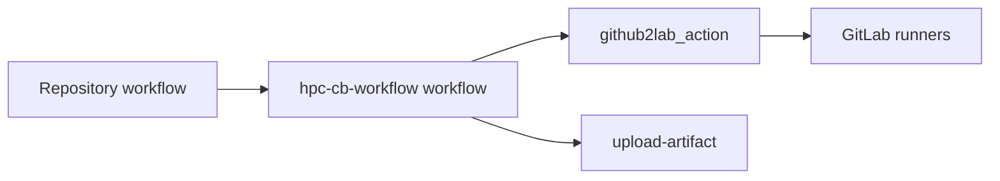

# HPC CB workflow

This reusable GitHub workflow runs pipelines through GitLab runners.
It mirrors commits, triggers pipelines, reports results and collects artifacts.
The caller supplies its events, GitLab pipeline and cluster configuration.



The workflow uses `pc2/github2lab_action` for GitLab operations.
GitHub's checkout and artifact actions handle source files and uploads.
All action references use full commit hashes.
The pinned action must recognize waiting pipelines and validate polling responses.
Dependency updates must use the same published action hash in both workflows.
Run the workflow tests against that published revision.

## Setup

1. Create a GitLab project with runners matching the caller's job tags.
   The caller's `.gitlab-ci.yml` defines the jobs and their resources.
2. Allow the access token to push and force push the mirrored branches.
   Disable pull mirroring for branches managed by this workflow.
3. Create a [GitLab access token][access-token] for this project.
   It needs `read_api` and `write_repository` scopes.
4. Create a token in GitLab Settings, CI/CD, Pipeline trigger tokens.
   Its owner can start the selected branch and supply pipeline variables.
   Cluster authorization may require a trigger token owned by a cluster user.
5. Configure the following settings in the caller's GitHub repository.
   They live under Settings, Secrets and variables, Actions.

| Setting | Type | Value |
| --- | --- | --- |
| `GITLAB_TOKEN` | Secret. | The access token. |
| `GITLAB_TRIGGER_TOKEN` | Secret. | The pipeline trigger token. |
| `GITLAB_HOSTNAME` | Variable. | The hostname without a protocol prefix. |
| `GITLAB_PROJECT_ID` | Variable. | The numeric GitLab project ID. |

The [manual caller example](examples/manual.yml) reads these settings.
Callers can also pass the hostname and project ID directly as inputs.
This workflow receives credentials from the caller.
It needs no GitLab secrets in its own repository.

[access-token]: https://docs.gitlab.com/user/project/settings/project_access_tokens/

## Caller interface

The caller grants `contents: read`, `checks: write` and `actions: write`.
It also grants `pull-requests: write` for result comments.
The [complete example](examples/manual.yml) supports manual dispatch.
Replace `REVIEWED_COMMIT` with the published workflow commit.

```yaml
permissions:
  contents: read
  checks: write
  actions: write
  pull-requests: write

jobs:
  hpc:
    uses: pc2/hpc-cb-workflow/.github/workflows/hpc-pipeline.yml@REVIEWED_COMMIT
    with:
      gitlab_hostname: gitlab.example.org
      gitlab_project_id: '123'
      pipeline_variables: EXPECTED_COMMIT_SHA=${{ github.sha }}
    secrets:
      GITLAB_TOKEN: ${{ secrets.GITLAB_TOKEN }}
      GITLAB_TRIGGER_TOKEN: ${{ secrets.GITLAB_TRIGGER_TOKEN }}
```

The caller passes `EXPECTED_COMMIT_SHA` to the GitLab pipeline.
The GitLab workflow accepts triggers only when that value matches its commit.
This prevents jobs for a different branch head from starting.
Keep this rule in every mirrored commit, identity checks after triggering cannot prevent jobs from starting.

```yaml
workflow:
  rules:
    - if: >-
        $CI_PIPELINE_SOURCE == "trigger" &&
        $EXPECTED_COMMIT_SHA == $CI_COMMIT_SHA
```

| Input | Meaning |
| --- | --- |
| `gitlab_hostname` | The GitLab hostname without a protocol prefix. |
| `gitlab_project_id` | The numeric GitLab project ID. |
| `pipeline_variables` | Pipeline variables, one `KEY=VALUE` per line. |
| `context_run_id` | The original GitHub run, used to resume monitoring. |
| `pull_request` | An optional PR whose head is the selected commit. |
| `max_wait_minutes` | Minutes one run monitors before continuing in another run, at most 330. |

## Monitoring and results

The workflow has three jobs, `start`, `wait` and `collect`.
Start force pushes the selected commit to the same branch on GitLab.
Mirroring skips push pipelines, one explicit trigger starts the jobs.
An optional PR number is checked against the selected commit before starting.
The pipeline identity and PR are stored in the original run's context artifact.
Only the first [run attempt][run-attempt] of a new GitHub run may start a pipeline.
Rerunning jobs uses the saved context without mirroring or triggering again.
If the context is missing, rerunning fails without starting jobs.
Check GitLab for an existing pipeline before dispatching a new run in that case.

[run-attempt]: https://docs.github.com/en/actions/reference/workflows-and-actions/contexts#github-context

Wait verifies the context's repository, workflow, branch and original commit.
It also verifies the GitLab project, pipeline ID, branch and commit.
Check names contain project and pipeline IDs to separate concurrent runs.
After `max_wait_minutes`, 330 by default, it dispatches the caller again with `context_run_id`.
Waiting for resources, callbacks, manual approval or a scheduled start remains nonterminal.
Cancellation remains nonterminal until GitLab confirms completion.
Continuation dispatches use the trusted default branch's workflow.
That branch contains a caller accepting the same continuation input.
The new run skips start and monitors the same pipeline.
The saved context preserves the original commit and PR as the branch advances.
Automatic continuation fails after seven days without dispatching another run.
The summary contains the original run ID for manual recovery.
Set `context_run_id` to that ID in the default branch caller to resume manually.
Continuation requires the access token, the trigger token is optional.
The caller exposes `context_run_id` as a workflow dispatch input.

Collect runs when the pipeline finishes, including after test failures.
It uploads artifacts to GitHub with a retention of thirty days.
Context artifacts have the same retention and contain no credentials.
Collection fails when the pipeline fails or its artifacts are unavailable.
For PR runs, one bot comment per pipeline reports the tested commit and result.
The comment includes artifact outcomes and links to GitLab and GitHub.
Repeated collection updates that comment.
The workflow publishes artifacts and PR status comments.
Benchmark history publication is a separate integration.

## Execution and credentials

Main branch pushes, manual dispatch and scheduled callers execute this workflow.
Maintainers authorize the exact source commit before cluster execution.
Main branch pushes and scheduled runs require code review before merging.
Review the caller workflow, GitLab configuration, included scripts and dependencies as executable code.
Dispatch a repository branch containing the reviewed commit and prevent changes until the run selects it.
For a fork PR, first place its reviewed commit on a branch in the caller repository.
The optional PR number checks commit identity, it does not grant approval or select a fork commit.
Protect the default branch and restrict workflow dispatch and repository configuration to trusted maintainers.
The default branch caller and its dependencies must remain trusted for automatic continuation.
Trust the configured GitLab host, project administrators and runner operators with the credentials and results.
Jobs execute with the CI account's filesystem and scheduler permissions.
This workflow provides no sandbox for approved source code.
Review includes access to that account's files, credentials and network resources.

GitLab tokens are passed only to the steps that use them.
Only start receives the trigger token.
Wait can update checks and dispatch the caller.
Collect can comment on PRs and has no workflow dispatch permission.
Steps share the runner and filesystem.
Artifact upload receives no explicit GitLab token.
Collected archives are stored without extraction or execution.
Python setup runs outside the source checkout with isolated imports.
The artifact download dependencies are pinned to pure Python wheels by hash.
The temporary authenticated GitLab remote is removed after mirroring.

## Verification

The repository's CI runs `tests/test_workflow.py` with mocked API responses.
It runs on pushes, pull requests and manual dispatch without GitLab secrets.
It does not validate live runner access or GitHub artifact transfers.
It checks exact commit mirroring, pipeline identity and failure propagation.
It also verifies token scopes, automatic continuation and repeated PR reporting.
Tests use PyYAML and the same pinned action revision as the workflow.
`GITHUB2LAB_SOURCE` selects that action's local Git checkout.
These checks submit no GitLab or Slurm jobs.
Local tests can use an uncommitted action worktree at the pinned base revision.
Passing those tests does not publish the action changes or update the workflow pins.

### Integration

The [integration workflow](.github/workflows/integration.yml) calls the reusable workflow without mocks.
It mirrors this repository's commit, its [pipeline](.gitlab-ci.yml) runs on the configured GitLab project.
Configure `GITLAB_HOSTNAME`, `GITLAB_PROJECT_ID`, `GITLAB_TOKEN` and `GITLAB_TRIGGER_TOKEN` in this repository as described in [Setup](#setup).
The GitLab project needs a runner with the `otus-shell` tag, override `INTEGRATION_RUNNER_TAG` in the project's CI/CD variables for another runner.
Every push to `main` runs the success scenario automatically.
Maintainers can dispatch any scenario on a reviewed branch.
A weekly schedule also runs the success scenario on the default branch.
The `verify` job reads the context artifact and compares GitLab and GitHub state.
It checks the pipeline commit, trigger variables, job results, check runs, collected archives and the PR comment.

| Scenario | Pipeline | Verified behavior |
| --- | --- | --- |
| `success` | One job with an artifact. | Collection, check runs and the PR comment. |
| `failure` | One failing job. | Artifacts are collected and the `hpc` job fails, the run is red by design. |
| `handover` | One job sleeping five minutes. | Monitoring stops after one minute and dispatches a continuation run. |

The continuation run uses the default branch's integration workflow and verifies the completed pipeline.
Merge changes to the continuation path before testing them with `handover`.
Set `pull_request` to a PR whose head is the selected commit to verify the PR comment.
